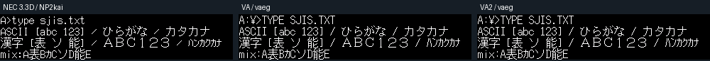

# J2a — Shift-JIS console output

**VA: 28/30. VA2: 28/30.** Both models display the same valid test text and filenames as NEC MS-DOS 3.3D, wrap the same way, and pass the requested regressions. The two strict NEC-parity failures are deliberate: NEC retains a pending lead through CR and through CLS, consuming the first printable byte afterward as a trail. J2a drops that lead so the control executes without corrupting subsequent output. Conventional memory cost: **80 bytes on each model**.



## Decisions and sources

- **Assemble pairs in CON, not in the DOS kernel or ROM string parser.** `OUTCHR` retains `81h–9Fh` / `E0h–FCh` across write requests, as in the [J1 DOS lead table](J1-dbcs-kernel.md). A trail in `40h–7Eh` / `80h–FCh` completes the pair. Use `INT 83h/AH=00h` (`Chuput`), with the lead in DH and trail in DL. The ROM owns character width, cursor movement, wrapping, and scrolling. The technical manual (`604TEXT.TXT` §6.4.3, function 1) documents both the Shift-JIS word and the `FEh` filler when only one column remains. VA/VA2 TVRAM confirms the filler; NEC comparison checks the visible result, not PC-98 VRAM contents.
- **Keep the documented ROM range for actual glyph lookup.** The manual lists `81h–9Fh` / `E0h–EFh` as Chuput's supported leads and specifies a full-width blank outside that range. Actual ROM output is not uniformly blank: direct Chuput and Putstr both show an unexpected glyph for `F040h` on VA and VA2. The NEC probe showed blank two-column slots for `F040h` and `FCFCh`. The driver consumes those extended leads and their valid trails as pairs but explicitly sends `8140h` for `F0h–FCh` leads. This does not claim NEC parity for every extended code point. [Raw ROM probe](J2a/raw-rom.png) and [CON/NEC comparison](J2a/invalid.png).
- **Single bytes.** Keep Putstr (`AH=02h`, current attribute, NUL terminator; §6.4.3 function 3) for ASCII, CR/LF/BS, and the additional ANK codes `80h`, `A0h–DFh`, and `FDh–FFh`. Both ROM entries displayed `A1h`, `B6h`, `DFh` as half-width kana in the direct probe. `80h` drew a visible glyph, and `A0h` and `FDh–FFh` occupied one visually blank column each, as on NEC. The probe distinguishes blank columns from dropped bytes with delimiters; TVRAM verifies the original byte values. A standalone `5Ch` stays ANK (yen on these screens), not a pair.
- **Malformed input and escape recovery.** NEC 3.3D in NP2kai executed CR/LF while retaining the lead: `95 0D 5A` displayed `瓢` (`955Ah`) at column 1, and `95 0A 59` drew `漂` (`9559h`) on the next line. `95 1B 5B 32 4A 1B 5B 48` did clear and home on NEC, but the next `C` in `CLS OK` was consumed into `匹` (`9543h`). NEC also displayed an extra full-width glyph for `95 7F` before the following `z`. To meet the no-swallow requirement, J2a drops a pending lead on an invalid trail, then handles that byte normally: CR/LF/BS still act, DEL is still filtered, and ESC enters the J0.4 parser. The four existing sequences, label layout, and unmatched-prefix replay stay in VAIO. The reverse case was also tested on VA/VA2: `ESC[>` followed by `95 5C` replays `[>` and draws `表`; an incomplete ESC prefix cannot consume a lead. No other controls or ESC sequences were added.
- **Gaiji (外字): yes, for a tested RAM code.** The technical manual's memory map (chapter 3, gaiji area) includes JIS `7621h`, Shift-JIS `EB9Fh`; §6.4.3 functions 31 and 33 describe Setfont and Getfont. The test COM saved that slot, registered an original full-width test bitmap, displayed it via direct Chuput and via CON, then restored the slot. Both paths showed the same glyph on both models, verified in TVRAM and screenshot pixels. [Gaiji capture](J2a/gaiji.png). Registration is **test-only**; no DOS registration service or startup loading was added. Half-width gaiji and other slots were **NOT RUN**.
- **Erase.** The J1 DOS editor's `KSTRIN.ASM` emits destructive backspace once per byte of a pair. The normal ROM/CON path erased both columns, so the driver needs no extra erase state. With redirected AH=0Ah, `X表Y` occupied four columns before erase; the `X表` + BS + `Y` fixture displayed `XY` with no stale right half and returned `02 58 59 0D`.

## Gate results

VA and VA2 used vaeg PR [#82](https://github.com/nakatamaho/vaeg/pull/82), `Rel.20261121 (m153, 6367e5d3)`, SHA-256 `a3ab65a03eac9fd2abccca3d51b8e464266a4b6141b9d5132b5b667495655906`. NEC reference: NP2kai SDL2 `5939e0c6d5985c4c08fc70f289a83290e5d3e6f7`, NEC MS-DOS 3.3D system disk 1 (guest `VER` reports 3.30). Counts are checks, not unique cold boots. See the [checker output and scenario completions](J2a/va-checks.txt).

| Brief item | VA | VA2 | Result and evidence |
|---|---:|---:|---|
| 1. `TYPE SJIS.TXT` | 1/1 | 1/1 | [Same text as NEC](J2a/type.png): hiragana, katakana, kanji, mixed ASCII, full-width ASCII and half-width kana. Includes `95 5C`, `83 5C`, and `94 5C` (表, ソ, 能). |
| 2. Column 80 wrap | 1/1 | 1/1 | [Same as NEC](J2a/wrap.png): 79 `A`s, blank column 80, then `表Z` from column 1 on the next row. VA/VA2 TVRAM holds `00FEh` in column 80. |
| 3. Split writes | 2/2 | 2/2 | [Same as NEC](J2a/split.png): `02: 表!` via two AH=02h calls and `40: ソ!` via two AH=40h writes. |
| 4. `DIR` | 1/1 | 1/1 | [Same seven J1 pair variants as NEC](J2a/dir.png) in a subdirectory. |
| 5. Redirected line input erase | 1/1 | 1/1 | [Same visual result as NEC](J2a/erase.png). Also checked exact AH=0Ah buffer and blank residual column on VA/VA2. |
| 6. Invalid sequences, strict NEC parity | 1/3 | 1/3 | [Lone `5Ch` matches](J2a/invalid.png). Lead + CR and [lead + CLS](J2a/pending-cls.png) do **not** match NEC's rendering; both vaeg models preserve subsequent text and return to the prompt. Lead + LF, lead + DEL, and ESC mismatch are supplemental cases. |
| 7a. J0.4 steps 1–5 | 10/10 | 10/10 | Boot labels (1), Shift/release (2), DIR and TYPE scroll (2), CLS/bytewise clear/home/redirected bytes (2), hide/show in block, bytewise and bottom-row reflow (3). |
| 7b. J0.3 steps 1, 5, 9 | 8/8 | 8/8 | DIR/F3/Enter (1), three cold boots of COPY CON/F10/Enter (3), BS/VER, Ctrl-X/F3, Ctrl-C/recovery and Ctrl-Z EOF (4). All COPY CON files contained `ABC\r\nDEF\r\n`. |
| 7c. KEY and CHKDSK | 3/3 | 3/3 | All 31 KEY list entries checked against IO.SYS (1); CHKDSK before and after (2). |
| **Total** | **28/30** | **28/30** | Supplemental raw ROM, gaiji and additional malformed-byte probes not included. |

| CHKDSK, distribution disks | Before | After | Delta |
|---|---:|---:|---:|
| VA | 530,432 B free | 530,352 B free | −80 B |
| VA2 | 530,432 B free | 530,352 B free | −80 B |

CHKDSK reported 655,360 bytes total in all four runs. `RESEND` grew by 77 bytes before paragraph rounding; IO.SYS grew by 80 bytes and remains within 20 boot sectors. The boot sector and the other 35 shipped files were unchanged by size and SHA-256. See [build comparison](J2a/build.txt). Physical hardware, 2D media, live Japanese keyboard/JFP, erase at a wrapped pair, other vaeg builds, and other ESC sequences: **NOT RUN**.

## Reproduce

- **Builds:** In scratch, use FreeDOS-88VA/freedos `main` at `7f467a2187a9e15c0c1bb84f179f214fe925153f`, `experiments/msdos4-va`. Point `components/msdos` at the local MS-DOS repository, reuse the locked emu2 revision, and set `msdos.commit` in two scratch copies of the lock: `6481929` baseline and `b55e6b3` J2a (full hashes in [build.txt](J2a/build.txt)). Run the unmodified `build.py --output "$OUT"` with `python3 -B` for each. The first J2a attempt failed MASM's short-jump range check; the final commit builds with zero warnings/errors from VAIO.ASM.
- **VA test media and runs:** `$S` is outside the repository. `$BUILDER_EXP` is the scratch `experiments/msdos4-va` directory; `$REG` has `LABELCHK.COM`, `CONKEY.COM` and `LONG.TXT` built as in [J0.4](J0.4-label-line.md#reproduce). `$BASE` and `$AFTER` are the distribution D88s.

  ```sh
  nasm -f bin tests/pc88va/SJISOUT.NAS -o "$S/SJISOUT.COM"
  nasm -f bin tests/pc88va/J1DBCS.NAS -o "$S/J1DBCS.COM"
  PYTHONPATH="$BUILDER_EXP" python3 -B tests/pc88va/sjis-media.py va \
    "$AFTER" "$S/test.d88" "$S/SJISOUT.COM" "$S/J1DBCS.COM" --regressions "$REG"
  PYTHONPATH="$VAEG_SOURCE/tools/qa" python3 -B tests/pc88va/sjis-run.py \
    "$VAEG" "$VA_ROMS" "$BASE" "$AFTER" "$S/test.d88" "$S/runs"
  PYTHONPATH="$BUILDER_EXP" python3 -B tests/pc88va/sjis-check.py "$S/runs"
  ```

  `SJISOUT.COM` SHA-256: `de7f4b6c2f2641c3f9e2f753265161f0d6abe0237d805cbe0a4e725f3b6c1283`. VA test D88 SHA-256: `28232ec7aad881448250a6947aba29c8319418104d0e7f65a60c0d2e562a6768`. The vaeg runner ensures each capture and the final `exit` event are present. The checker verifies guest output, selected raw TVRAM words, selected screenshot pixels, and FAT file contents. NEC parity is judged visually.
- **NEC:** Reuse the [J0.3b NP2kai and ROM setup](J0.3b-editing-keys.md#reproduce) and the SHA-verified NEC system disk 1. Run `sjis-media.py nec` with that disk, a scratch output path and the same two COM files (no `--regressions`). Boot the scratch image by absolute path in Xvfb, cancel INSTDOS with Escape and Return when on the install-target screen, and leave MENU with F9. At the prompt run `VER`, `TYPE SJIS.TXT`, `SJISOUT W`, `SJISOUT S`, `SJISOUT I`, `SJISOUT C`, `J1DBCS L < NOERASE.IN`, `J1DBCS L < BS.IN`, `J2MAKE` and `DIR J2DIR`, capturing the screen after each. `SJISOUT P`, `G`, and `R` are VA-only probes. No NEC media, ROM, manual, or extracted files are committed.
